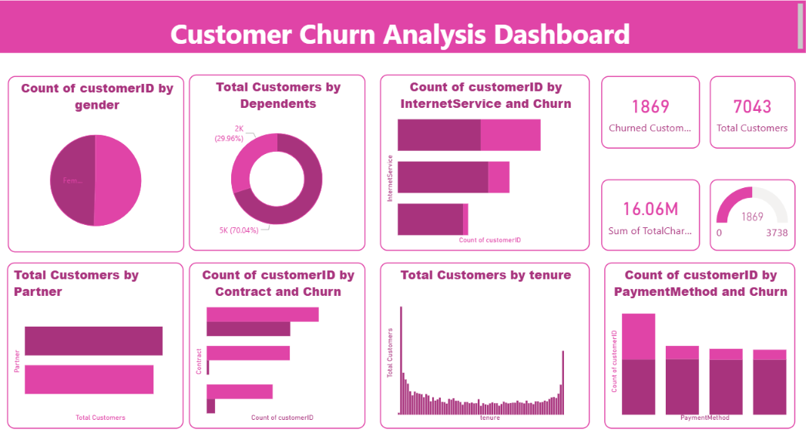

# Customer Churn Analysis and Prediction (Power BI)

Analyze customer churn for a telecommunications company and build a Power BI dashboard that identifies at-risk customers and supports actionable retention recommendations.

## Table of Contents

- [Project Overview](#project-overview)
- [Dashboard Preview](#dashboard-preview)
- [Objectives](#objectives)
- [Tasks](#tasks)
- [Dashboard Components](#dashboard-components)
- [Included Power BI Report](#included-power-bi-report)
- [Tools and Skills](#tools-and-skills)
- [Repository Structure](#repository-structure)
- [How to Run](#how-to-run)
- [Data Preparation Checklist](#data-preparation-checklist)
- [Suggested DAX Measures](#suggested-dax-measures)
- [Deliverables](#deliverables)
- [Key Findings and Recommendations](#key-findings-and-recommendations)

## Project Overview

A telecommunications company is losing customers. Using the provided customer churn dataset, this project builds an interactive Power BI dashboard that reveals churn patterns, highlights which customer segments are most at risk, and leads to clear recommendations for improving customer retention.

> **Note:** Complete all tasks listed below.

## Dashboard Preview



*Customer Churn Analysis Dashboard built in Power BI (`Visual.pbix`).*

## Objectives

1. **Analyze** churn patterns across the customer base.
2. **Identify** the customers and segments most at risk of leaving.
3. **Recommend** actions that reduce churn and improve retention.

## Tasks

| # | Task | Description | Skills Tested |
|---|------|-------------|---------------|
| 1 | Data Connection | Import the customer churn dataset into Power BI so it is ready for visualization. | Importing data, connecting data sources |
| 2 | Data Transformation | Clean and transform the data: missing values, incorrect data types, duplicates, inconsistent values. | Data cleaning, transformation, preprocessing (Power Query) |
| 3a | Churn Rate Overview | Show the percentage of customers who have churned. | Cards, KPIs, donut charts |
| 3b | Customer Demographics | Visualize gender, partner status and dependent status. | Bar charts, pie charts |
| 3c | Customer Tenure Analysis | Show the distribution of customer tenure (in months). | Histograms, box plots |
| 3d | Churn Analysis | Analyze churn by contract type, payment method and internet service. | Stacked bar charts, heatmaps |

## Dashboard Components

- **Churn Rate Overview:** a KPI card with the overall churn percentage and a churned vs. retained donut chart.
- **Customer Demographics:** bar or pie charts for gender, partner status and dependent status.
- **Customer Tenure Analysis:** a histogram (binned tenure in months) or box plot, optionally split by churn status.
- **Churn Analysis:** stacked bar charts or a heatmap showing churn by contract type, payment method and internet service.

## Included Power BI Report

The file **`Visual.pbix`** is the completed dashboard for this project. It has a single report page titled **Customer Churn Analysis Dashboard**, built on the Telco customer churn dataset.

| Dashboard Area | Visual | Fields Used |
|----------------|--------|-------------|
| Header | Text box with the dashboard title | n/a |
| Churn Rate Overview | Gauge | Churned Customers |
| KPI Cards | Card, Card, Card | Total Customers, Churned Customers, TotalCharges (sum) |
| Demographics: Gender | Pie chart | gender, count of customerID |
| Demographics: Partner | Clustered bar chart | Partner, Total Customers |
| Demographics: Dependents | Donut chart | Dependents, Total Customers |
| Tenure Analysis | Clustered column chart | tenure, Total Customers |
| Churn by Contract | Clustered bar chart | Contract, Churn, count of customerID |
| Churn by Payment Method | Column chart | PaymentMethod, Churn, count of customerID |
| Churn by Internet Service | Bar chart | InternetService, Churn, count of customerID |

Custom measures in the model include **Total Customers** and **Churned Customers**.

**To open it:** double-click `Visual.pbix` (Power BI Desktop required). If the data does not load, update the source path under **Home > Transform data > Data source settings**, then select **Refresh**.

## Tools and Skills

- Power BI Desktop (Power Query, data modeling, DAX, report visuals)
- Data cleaning and preprocessing
- Data visualization and dashboard design

## Repository Structure

```
.
├── data/
│   └── customer_churn.csv          # Provided dataset (add your copy here)
├── Dashboard.png                   # Dashboard screenshot used in this README
├── Visual.pbix                     # Completed dashboard (Tasks 1 to 3d)
├── task1_data_connection.pbix      # Optional: separate file per task
├── task2_data_transformation.pbix
├── docs/
│   ├── Customer_Churn_Analysis_Task.pptx
│   └── Customer_Churn_Analysis_Task.pdf
└── README.md
```

Adjust file names to match your own work. Keep a separate file for each task or level.

## How to Run

1. Install **Power BI Desktop** (Windows).
2. Place the churn dataset in the `data/` folder.
3. Open `Visual.pbix` (or the relevant task `.pbix` file) in Power BI Desktop.
4. If the data source path has changed, go to **Home > Transform data > Data source settings** and point it to your local file.
5. Select **Refresh** to reload the data.

## Data Preparation Checklist

- [ ] Promote the first row to headers and confirm column names.
- [ ] Set correct data types (for example, convert `TotalCharges` from text to a decimal number, and `SeniorCitizen` to text or Yes/No if used as a category).
- [ ] Handle missing or blank values (for example, blank `TotalCharges` for new customers).
- [ ] Remove duplicate rows.
- [ ] Standardize inconsistent values (for example, "No internet service" and "No phone service" labels).
- [ ] Create a numeric churn flag (`Churn = Yes` becomes 1, otherwise 0) for calculations.
- [ ] Create tenure bins (for example, 0-12, 13-24, 25-36, 37-48, 49-60, 61-72 months).

Column names above follow the common telecom churn dataset. Use the names in your provided dataset.

## Suggested DAX Measures

```DAX
Total Customers = COUNTROWS ( Customers )

Churned Customers =
CALCULATE ( COUNTROWS ( Customers ), Customers[Churn] = "Yes" )

Churn Rate % =
DIVIDE ( [Churned Customers], [Total Customers] )
```

## Deliverables

- A Power BI file (`.pbix`) for each task or level.
- A short written summary of key findings and recommendations for reducing churn.


## Academic Integrity

Build the dashboard and write your analysis yourself. Do not copy code, DAX or reports from other sources.
